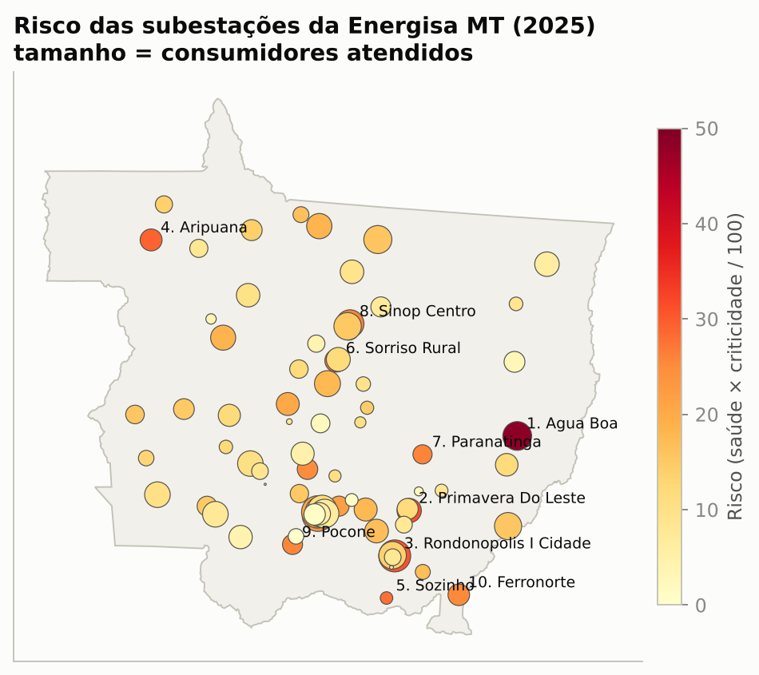
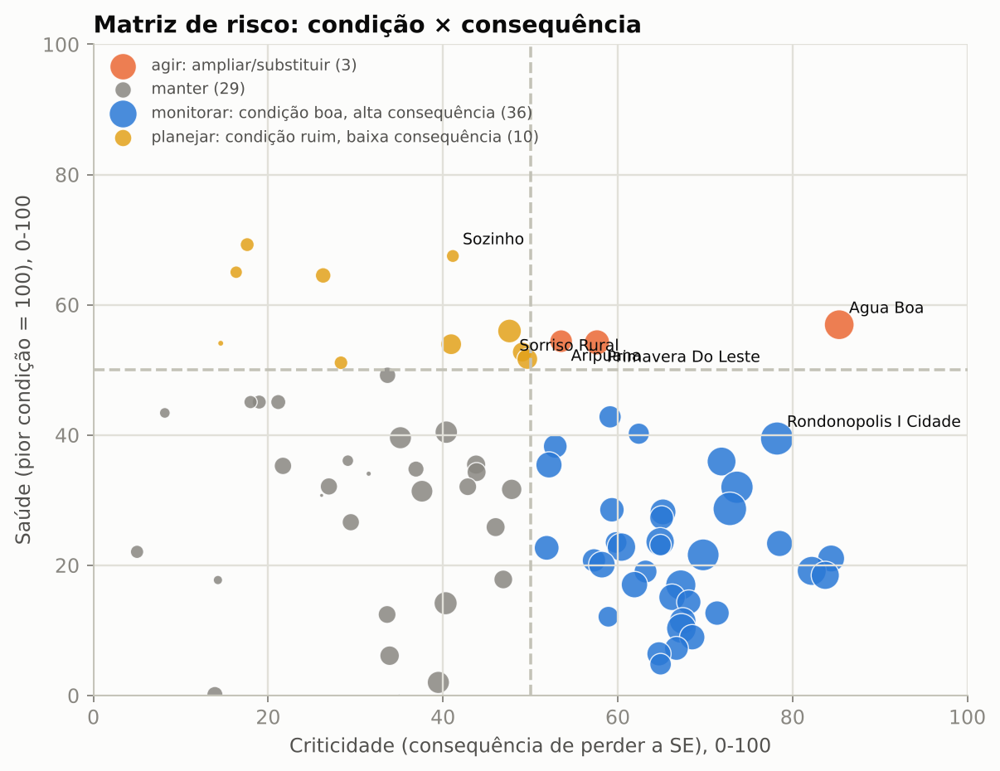
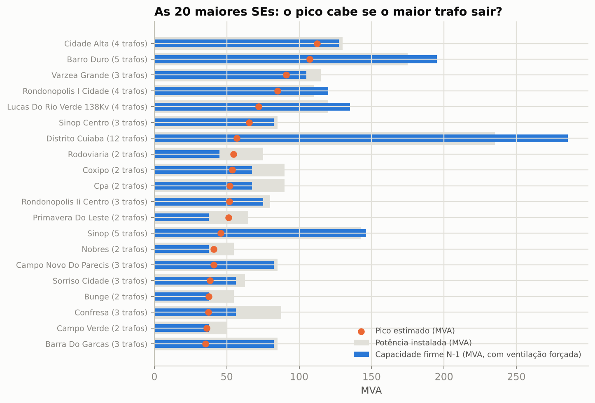
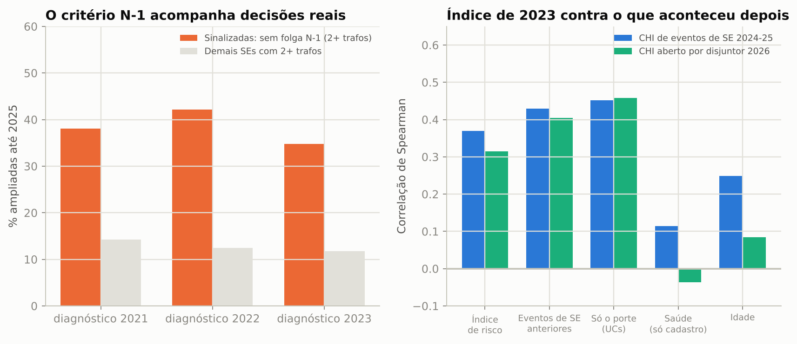
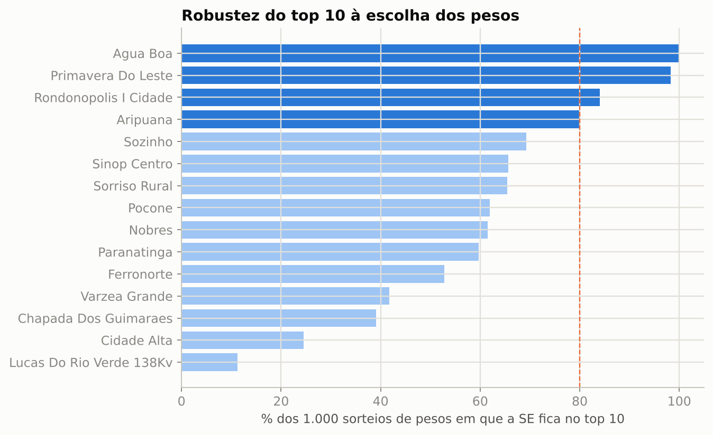

# Índice de saúde e criticidade de subestações

[](https://github.com/CaioNepomuceno2/substation-health-index/actions/workflows/ci.yml)

-0b7a75)

**Quais subestações da Energisa Mato Grosso têm maior risco, por quê e onde investir primeiro?**

Este projeto monta, só com dados abertos da ANEEL, um **índice de saúde × criticidade** para as subestações
(SEs) que suprem a rede de média tensão da Energisa MT. É a lógica de gestão de ativos da ISO 55000 e da
metodologia CNAIM (Health Index × Criticality = Risk), numa versão transparente: cada indicador vem do cadastro
da rede (BDGD) ou das interrupções, e cada peso está em [`configs/premissas.yaml`](configs/premissas.yaml).
O índice foi testado contra o que aconteceu depois e contra decisões reais de ampliação.

## Resultados em uma tela

Snapshot de 31/12/2025: **78 SEs** com transformador de alta para média tensão e carga cadastrada, que atendem
**2,03 milhões** de unidades consumidoras (UCs).

| | |
|---|---|
| SEs com **um único trafo de MT** (sem capacidade firme na própria SE) | **36 de 78**, com **363 mil UCs** (18%) |
| UCs em alimentadores **sem chave NA para alimentador de outra SE** | **1,13 milhão** (56%) |
| SEs com 2 ou mais trafos cujo pico estimado **não cabe se o maior trafo sair** | **6** (Primavera do Leste, Rodoviária, Nobres e três no limite) |
| SEs com pico estimado acima de 80% da potência instalada | 4 (nenhuma acima de 100%) |
| SEs sinalizadas sem folga N-1 com 2+ trafos que **a distribuidora ampliou** até 2025 | **35% a 42%**, contra 12% a 14% das demais (diagnósticos de 2021, 2022 e 2023) |
| Índice de 2023 contra o CHI de eventos de SE em 2024-2025 | Spearman 0,37 (p = 0,001), **igual aos baselines de porte e de histórico**; a condição cadastral sozinha não antecipa falhas |
| Eventos de SE (interrupção simultânea em 3+ alimentadores) | 187 por ano, **2,6% do CHI** das falhas de MT |



## 1. O índice

Duas notas de 0 a 100 por SE, calculadas com o snapshot de 2025 e as interrupções de 2023 a 2025:

* **Saúde (condição):** carregamento no pico estimado (30%), déficit N-1 (30%), idade do trafo mais antigo
  (20%), eventos de SE por 100 mil UCs (15%) e perda no ferro acima do esperado para o porte (5%).
* **Criticidade (consequência de perder a SE):** consumidores atendidos (45%), energia (20%), fração das UCs sem
  rota de transferência para outra SE (20%) e se é a única SE do município (15%).
* **Risco** = saúde × criticidade / 100. A matriz divide as SEs em quatro grupos de ação.



| # | Subestação | Grupo | Risco | Por que a saúde pesa | UCs |
|---|---|---|---|---|---|
| 1 | Água Boa 138 kV | agir | 48,6 | trafo mais antigo com 33 anos; eventos de SE frequentes; 98% das UCs sem rota de transferência | 66,5 mil |
| 2 | Primavera do Leste 138 kV | agir | 31,3 | pico de 51 MVA para 37,5 MVA firmes (déficit N-1 de 14 MVA) | 34,2 mil |
| 3 | Rondonópolis I Cidade 138 kV | monitorar | 30,9 | trafo mais antigo com 39 anos; 77% de utilização no pico | 102,1 mil |
| 4 | Aripuanã 138 kV | agir | 29,1 | um trafo só; 7,3 eventos de SE por ano | 22,6 mil |
| 5 | Sozinho 138 kV | planejar | 27,8 | um trafo só; 81% de utilização; fluxo reverso o ano inteiro | 2,4 mil |
| 6 | Sorriso Rural 69 kV | planejar | 26,7 | eventos de SE; idade | 26,7 mil |
| 7 | Paranatinga 138 kV | planejar | 25,9 | um trafo só; eventos de SE | 13,1 mil |
| 8 | Sinop Centro 138 kV | monitorar | 25,8 | 77% de utilização; idade | 58,9 mil |
| 9 | Poconé 138 kV | planejar | 25,7 | um trafo só; 77% de utilização | 15,7 mil |
| 10 | Ferronorte 138 kV | monitorar | 25,3 | um trafo só | 21,0 mil |

A lista completa, com todos os indicadores, está em [`reports/indice_2025.csv`](reports/indice_2025.csv). Água
Boa, Aripuanã, Sorriso Rural e Paranatinga têm carregamento marcado como **incerto** (o cadastro liga parte dos
alimentadores a um trafo de outra tensão); nelas, a nota de saúde não usa o carregamento.

**O que isso significa:** quase metade das SEs não tem capacidade firme própria. Nelas, a confiabilidade
depende de transferir carga pela rede de MT, e 56% das UCs estão em alimentadores sem chave para outra SE. A
lista de risco mistura dois tipos de problema que pedem ações diferentes: falta de capacidade (Primavera do
Leste, Rodoviária, Nobres) e SEs grandes, antigas ou com histórico de eventos, que pedem inspeção e ensaio.

## 2. Capacidade firme (N-1)



O pico de cada SE é estimado a partir da energia mensal dos alimentadores supridos pelos seus trafos (maior
mês, dividido por um fator de carga de 0,72 e fator de potência de 0,92). A capacidade firme é a soma das
potências com ventilação forçada menos a do maior trafo. Entre as 20 maiores SEs, só Primavera do Leste
(déficit de 13,9 MVA), Rodoviária (9,5 MVA) e Nobres (3,4 MVA) não suportam a perda do maior trafo no pico; Bunge
e Campo Verde ficam no limite. As maiores do estado, Cidade Alta e Várzea Grande, têm folga de 14 a 15 MVA, cerca
de 13% a 16% do pico.

O número de SEs com 2+ trafos sem folga N-1 é **sensível ao fator de carga**: 2 com 0,82 e 10 com 0,62. A
ordem de risco quase não muda (Spearman de 0,95 e 0,98 com o caso base). Por isso a lista vale mais como ordem
de prioridade do que como contagem exata.

## 3. Validação

### 3.1 O critério N-1 acompanha decisões reais

Para cada diagnóstico (2021, 2022 e 2023), comparei as SEs sinalizadas com o cadastro de 2025. Os códigos de SE
mudaram entre 2022 e 2023, então o pareamento é feito pela coordenada (SE mais próxima a menos de 1 km).

| Diagnóstico | SEs com 2+ trafos sem folga N-1 | Ampliadas até 2025 | Demais SEs com 2+ trafos | Ampliadas até 2025 |
|---|---|---|---|---|
| 2021 | 21 | 8 (38%) | 35 | 5 (14%) |
| 2022 | 19 | 8 (42%) | 24 | 3 (12%) |
| 2023 | 23 | 8 (35%) | 34 | 4 (12%) |

Ampliação = mais um trafo ou pelo menos 10% a mais de potência instalada de MT. No diagnóstico de 2023, 5 das
8 SEs com pico acima de 80% da potência foram ampliadas (63%), contra 14% das demais.

**O que isso significa:** com dados públicos, o critério aponta as SEs em que a própria distribuidora acabou
investindo, cerca de 3 vezes mais que nas demais. É evidência de que o diagnóstico de capacidade conversa com o
planejamento real.

### 3.2 O índice de 2023 antecipa as falhas de 2024-2026?

O índice foi montado só com o snapshot de 2023 e as interrupções de 2021 a 2023. Os resultados medidos depois
nunca entram no índice:

| Correlação de Spearman (72 SEs) | CHI de eventos de SE 2024-25 | CHI aberto por disjuntor, jan-jul/2026 |
|---|---|---|
| Índice de risco | **0,37** (p = 0,001) | **0,31** (p = 0,01) |
| Só o porte (UCs) | 0,45 | 0,46 |
| CHI de eventos de SE nos 3 anos anteriores | 0,43 | 0,40 |
| Saúde só com dados cadastrais (sem histórico) | 0,11 (n.s.) | -0,04 (n.s.) |
| Idade | 0,25 | 0,08 |



**O que isso significa:** o índice ordena bem onde o problema vai pesar (as 20% de maior risco concentram 42% do
CHI de eventos de SE de 2024-2025), mas **não é melhor que olhar só o porte ou o histórico**. A condição que dá
para ler no cadastro público (carregamento, N-1, idade, perdas) **não antecipa falhas**. Também na taxa por UC,
o único preditor útil é a própria taxa passada (Spearman 0,41). Isso não é defeito do método: falha de
equipamento de SE depende de condição física (óleo, buchas, comutador, proteção), que não está na BDGD. A seção
"Na prática" mostra como os dados internos entram nessa dimensão.

### 3.3 Robustez dos pesos

Sorteei 1.000 conjuntos de pesos ao redor dos definidos (Dirichlet). A ordem de risco se mantém (Spearman mediano
de 0,92; percentil 5 de 0,79), mas só 4 SEs ficam no top 10 em pelo menos 80% dos sorteios: Água Boa, Primavera
do Leste, Rondonópolis I Cidade e Aripuanã. As posições 5 a 10 dependem da escolha dos pesos.



## 4. Quanto vale e onde investir

* **Risco em R$ (visão social):** R$ 4,8 mi por ano no conjunto das SEs. R$ 4,0 mi vêm do CHI dos eventos de SE
  (R$ 5,94 por consumidor-hora, média da frota calculada no [`automation-impact`](https://github.com/CaioNepomuceno2/automation-impact))
  e R$ 0,84 mi da energia não suprida esperada se um trafo falha e a carga não cabe nos demais (premissas
  ilustrativas: 1% de falha grave por trafo por ano, 72 h para repor, R$ 7.000/MWh).
* **Ampliar não se paga só com energia não suprida.** Há 29 SEs sem folga N-1 com carregamento confiável; cobrir
  o déficit exigiria 271 MVA, cerca de R$ 54 mi a R$ 200 mil/MVA (custo ilustrativo). Com as premissas acima,
  nenhuma ampliação tem benefício maior que o custo anualizado. Ela só empata se a reposição levar mais de
  **cerca de 23 dias** (mediana entre as candidatas).
* **O que isso significa:** para a maioria das SEs de um trafo só, a resposta mais barata para o risco N-1 é
  **repor rápido** (subestação móvel, trafo reserva regional) e **criar rotas de transferência** pelas chaves NA,
  não instalar um segundo trafo. A ampliação se justifica onde há carga crescente ou déficit grande no pico, como
  em Primavera do Leste e Rodoviária.

## Na prática: o que muda para quem decide

### O problema hoje

A priorização de subestações costuma partir de listas de carregamento em planilha, de reclamações e da
experiência de cada regional. Essa lista não junta, num número só, a condição do equipamento e a consequência de
perdê-lo. Os números deste projeto mostram por que isso importa: 36 das 78 SEs têm um trafo só, 56% das UCs não
têm rota de transferência para outra SE e a lista de risco mistura problemas de capacidade com problemas de
condição.

### O que se ganha

| Ganho | Quanto | De onde vem o número |
|---|---|---|
| Lista única e auditável de SEs por risco | 78 SEs, 4 grupos de ação, fatores de cada nota | Medido (cadastro BDGD + interrupções) |
| Diagnóstico N-1 alinhado às decisões reais | SEs sinalizadas ampliadas 3 vezes mais (35% a 42% contra 12% a 14%) | Medido (snapshots 2021-2025) |
| Ordem de onde o problema vai pesar | Top 20% concentra 42% do CHI de eventos de SE de 2024-25 | Medido (backtest; igual ao baseline de porte) |
| Mapa das SEs sem rota de transferência | 1,13 milhão de UCs | Medido (topologia BDGD 2025) |
| Valor do risco e da ampliação | R$ 4,8 mi/ano; ampliar só empata com reposição de cerca de 23 dias | **Premissa** (taxa de falha, horas de reposição, custos) |

### Por que aplicar

* **Plano de obras:** o déficit N-1 e o carregamento são a base técnica do plano de expansão das SEs. Uma lista
  auditável facilita defender cada obra, inclusive na revisão tarifária, em que o investimento prudente é
  discutido com a ANEEL.
* **Continuidade:** os eventos de SE são poucos (2,6% do CHI de falhas de MT), mas cada um atinge vários
  alimentadores de uma vez. Saber onde eles se repetem orienta manutenção e proteção.
* **Estratégia de reposição:** a análise de valor mostra quando um segundo trafo compensa e quando é melhor ter
  subestação móvel e transferência. Isso muda o tipo de investimento, não só a ordem.

### Como aplicar (roteiro de adoção)

1. **Trocar a energia mensal da BDGD pela medição horária da SE.** A medição de fronteira ou o SCADA da
   subestação dá o pico real de cada trafo, no lugar da estimativa com fator de carga (`fator_carga_se` em
   `configs/premissas.yaml`). É a mudança que mais melhora o déficit N-1.
2. **Pôr a condição física na nota de saúde:** cromatografia do óleo (DGA), ensaios de isolamento, termografia,
   histórico de manutenção e de falhas de cada trafo, disjuntor e proteção. É exatamente o que falta no dado
   público, como mostra a validação (seção 3.2).
3. **Incluir a saúde da automação da SE:** disponibilidade de comunicação e assertividade dos comandos da
   telemetria de cada SE (RTU, disjuntores e religadores de saída), calculadas a partir do histórico de alarmes
   do SCADA. Entra como mais um indicador em `pesos.saude`, sem mudar o código.
4. **Calibrar as premissas:** taxa de falha por idade e tecnologia, tempo real de reposição (com e sem
   subestação móvel) e custo de ampliação do banco de preços.
5. **Piloto com a engenharia de manutenção:** comparar o top 10 com a lista atual da equipe, inspecionar as SEs
   em que as duas listas divergem e medir em 12 meses se as SEs de maior risco concentram os eventos.
6. **Rotina:** rodar a cada novo snapshot ou mensalmente com a medição da SE. `reports/indice_2025.csv` já está
   no formato de tabela fato para o Power BI (uma linha por SE, com notas, fatores e R$).

**Critério de sucesso do piloto:** o índice com dados internos deve superar os baselines de porte e de histórico
na validação da seção 3.2, que com dados públicos ele só empata.

### Limites de uso

* Não use o pico estimado como medição: ele depende do fator de carga, e a contagem de SEs sem folga N-1 varia
  de 2 a 10 conforme essa premissa.
* Não use a nota de saúde pública para prever falha de um equipamento específico: ela não antecipa falhas
  (seção 3.2).
* Os R$ de risco e de ampliação dependem de premissas ilustrativas; servem para comparar alternativas, não como
  orçamento.
* As posições 5 a 10 do ranking mudam com os pesos; decida sobre as 4 SEs estáveis e investigue as demais.

## Metodologia

Resumo: painel por SE em cada snapshot da BDGD de 2021 a 2025, com carregamento, capacidade firme, idade, perdas,
consumidores e topologia de transferência; eventos de SE identificados como interrupções simultâneas em 3 ou mais
alimentadores; notas por interpolação linear entre "bom" e "ruim"; validação com cortes temporais.
Detalhes, fórmulas e decisões de dados em [`docs/metodologia.md`](docs/metodologia.md).

## Reproduzir

O projeto usa as interrupções harmonizadas e os crosswalks de alimentador do projeto irmão
[`distribution-asset-risk`](https://github.com/CaioNepomuceno2/distribution-asset-risk), que precisa estar
clonado ao lado deste repositório.

```bash
git clone https://github.com/CaioNepomuceno2/distribution-asset-risk ../distribution-asset-risk
(cd ../distribution-asset-risk && pip install -e . && python scripts/build_interrupcoes.py && python scripts/build_bdgd.py)
pip install -e ".[dados,dev]"
python scripts/00_cache_bdgd.py        # 8 snapshots da BDGD (~1 GB cada, baixados e apagados um a um)
python scripts/01_paineis.py           # indicadores por SE, 2021-2025
python scripts/02_indice_decisao.py    # índice 2025, sensibilidade, R$ e ordem de investimento
python scripts/03_validacao.py         # índice 2023 contra 2024-2026 e ampliações reais
python scripts/04_figuras.py
pytest
```

## Estrutura

```
src/sehealth/
  dados.py         leitura do cache da BDGD: trafos de SE (UNTRAT/EQTRAT), alimentadores (CTMT), SUB
  carregamento.py  carga mensal por SE, pico, utilização, capacidade firme N-1, perdas
  eventos.py       interrupções por SE e eventos de SE (simultâneos em N alimentadores)
  topologia.py     interligações entre SEs pelas chaves NA (UNSEMT + SSDMT)
  painel.py        tabela de indicadores por SE em um snapshot, sem informação futura
  indice.py        notas 0-100, saúde, criticidade, risco, quadrantes, sensibilidade dos pesos
  valor.py         energia não suprida N-1, R$ de risco, custo e benefício de ampliar
  validacao.py     Spearman, captura do top, ampliações entre snapshots
scripts/           00 cache BDGD, 01 painéis, 02 índice e decisão, 03 validação, 04 figuras
configs/           premissas.yaml (pesos, limiares, premissas de valor)
reports/           CSV/JSON dos resultados e figuras
docs/              metodologia e decisões de dados
```

## Limitações

* **Carregamento estimado:** a BDGD só tem energia mensal. O pico vem de um fator de carga, e o número de SEs sem
  folga N-1 é sensível a ele.
* **Vínculo alimentador → trafo:** em 15 SEs, parte da energia vem de alimentadores cuja tensão não bate com o
  secundário do trafo apontado no cadastro. Nelas o carregamento não entra na nota.
* **Energia líquida da GD:** a energia dos alimentadores é líquida da geração distribuída e cai em muitas SEs. Por
  isso o crescimento de carga ficou fora do índice (é só informativo), e 13 SEs têm meses de fluxo reverso.
* **Condição física ausente:** sem DGA, ensaios e histórico de manutenção, a nota de saúde não antecipa falhas.
* **Eventos de SE são um rastro, não uma causa:** a base de interrupções não diz qual equipamento da SE falhou.
  Interrupções simultâneas em 3+ alimentadores podem vir de falha na SE, no suprimento em alta tensão ou de clima.
* **Transferência pela topologia:** só existe nos snapshots de 2024 e 2025, então não entra no índice de
  validação (2023). Chave NA não garante folga no alimentador vizinho.
* **SE única no município** usa o município de localização da SE, não o das UCs atendidas.
* **Premissas de valor ilustrativas:** taxa de falha, horas de reposição e custo por MVA.

---
Autor: **Caio Nepomuceno**. Dados públicos da ANEEL (BDGD e interrupções). Projeto independente, sem vínculo com a
Energisa ou com a ANEEL.
