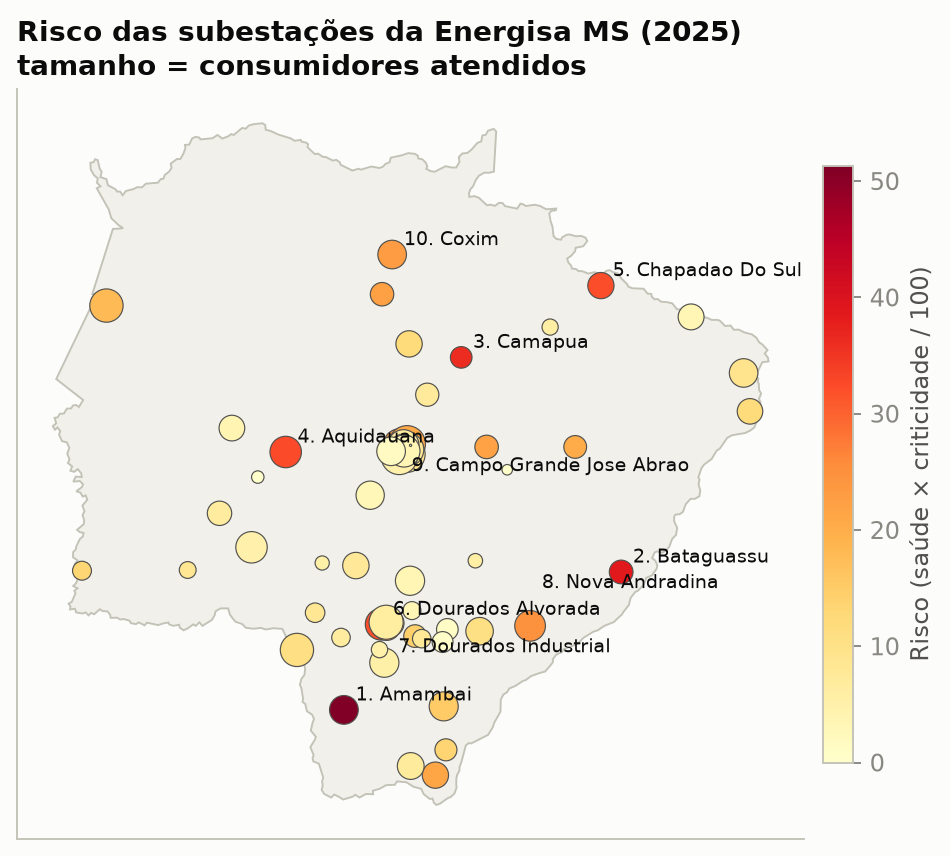
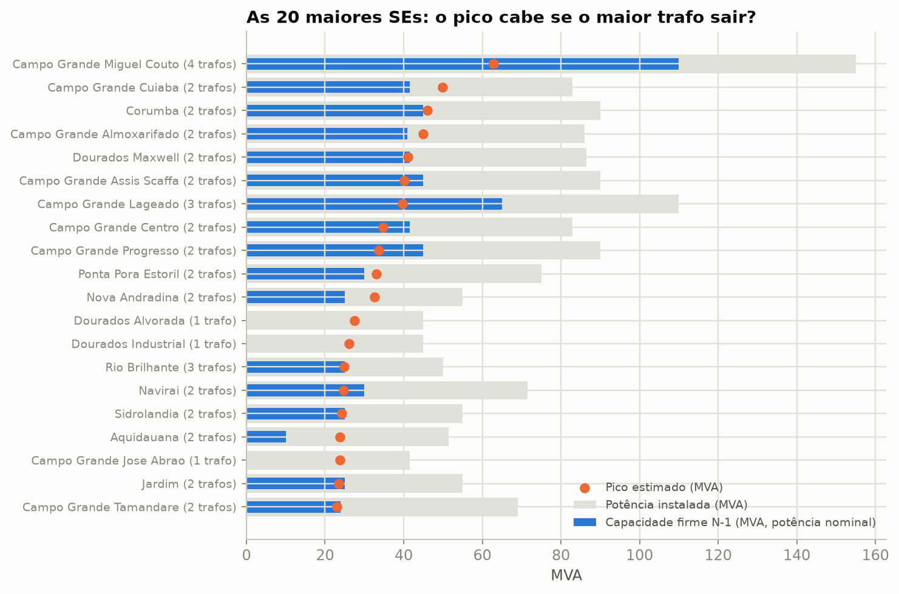
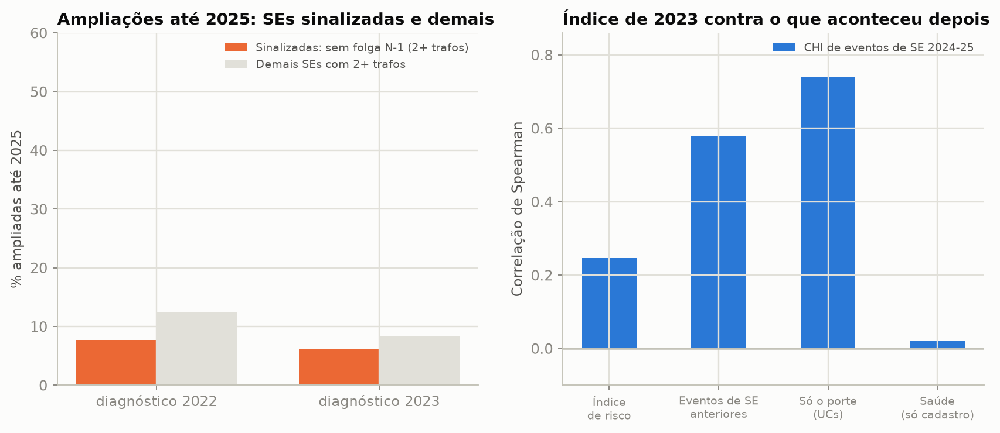

# Resultados da Energisa MS (EMS)

Índice de saúde × criticidade das subestações (SEs) da Energisa Mato Grosso do Sul, com o snapshot da BDGD de
31/12/2025. Todo número desta página sai de arquivos regenerados em [`reports/ems/`](../reports/ems/) (execução de
07/11/2026, com `--config configs/premissas_ems.yaml`). Os números de MT citados para comparação vêm dos arquivos de MT
publicados neste repositório (`reports/`), lidos sem regerar; os quilômetros de rede e os consumidores de MT e MS, do
`reports/ems/diagnostico/comparacao_descritiva.csv` do
[`distribution-asset-risk`](https://github.com/CaioNepomuceno2/distribution-asset-risk). **As decisões de dados e as
portas de qualidade foram escritas antes dos resultados**, em [`decisoes_ems.md`](decisoes_ems.md).

> Projeto independente, sem vínculo com a Energisa ou com a ANEEL. Só dados abertos (ANEEL e IBGE).

## Leia primeiro

* **O que a validação deixou publicar.** Passaram as portas pré-registradas os eventos de SE de 2024-2025 (porta (b)) e as
  ampliações reais dos diagnósticos de 2022 e 2023 (porta (c)). **Não passaram** as aberturas por disjuntor de 2026 (só
  18 SEs do índice com abertura, mínimo 30; seção 4.3) e as ampliações do diagnóstico de 2021 (só 8 SEs não
  sinalizadas, mínimo 10; seção 4.1): **para esses dois não há afirmação de validação**.
* **O índice de MS não antecipa melhor que o porte ou o histórico.** O Spearman do índice de 2023 com o CHI de eventos de
  SE de 2024-2025 é 0,25 (p = 0,067), contra 0,74 só do porte e 0,58 do histórico (seção 4.2). E as SEs
  sinalizadas sem folga N-1 **não foram mais ampliadas** que as demais (seção 4.1). Em MT, o índice ficou igual aos baselines
  e as sinalizadas foram ampliadas cerca de 3 vezes mais.
* **Capacidade pela potência nominal.** Em MT a capacidade firme usa os estágios de ventilação forçada do cadastro. Em
  MS os estágios de 2025 são 1,25x e 1,5x da nominal em todos os trafos, e o N-1 de MS usa a nominal
  ([`decisoes_ems.md`](decisoes_ems.md), seção 5). A contagem de SEs sem folga N-1 **não é comparável** com a de MT; a
  seção 3 traz as duas bases.
* **12 das 59 SEs (20%) têm carregamento incerto** (o cadastro liga menos de 80% da energia da SE a
  circuitos coerentes). Nelas a nota de saúde não usa o carregamento, e o peso volta para os outros indicadores. 5
  das 10 primeiras do ranking e 7 das 12 primeiras são dessas; a seção 2 traz o ranking só entre as confiáveis.
* **R$ com rótulo.** Toda saída de R$ leva `origem_efeito = "transportado de MT"` e o R$ por CHI de MS (R$ 5,56 social
  e R$ 2,15 de compensação, do `valor.json` de MS), nunca os de MT. Este repositório não usa o efeito do religador, mas
  o campo vem do mesmo arquivo e é repetido por rigor (seção 5).

## 1. Resultados em uma tela

Snapshot de 31/12/2025: **59 SEs** com transformador de alta para média tensão, carga cadastrada e código de SE, que atendem
**1,38 milhão** de UCs. A coluna de MT é a publicada no README de MT; a base de capacidade dela é outra.

|  | Energisa MS | Energisa MT (publicado) |
|---|---|---|
| SEs com **um único trafo de MT** (sem capacidade firme na própria SE) | **27 de 59**, com **335 mil UCs** (24%) | 36 de 78, com 363 mil UCs (18%) |
| UCs em alimentadores **sem chave NA para alimentador de outra SE** | **0,65 milhão** (47%) | 1,13 milhão (56%) |
| SEs com 2 ou mais trafos cujo pico estimado **não cabe se o maior trafo sair** | **9** pela potência nominal; 3 pelos estágios de ventilação cadastrados (a base de MT) | 6 (estágios de ventilação) |
| SEs com pico estimado acima de 80% da potência instalada | 0 (a maior utilização estimada é 70%) | 4 (nenhuma acima de 100%) |
| SEs sinalizadas sem folga N-1 com 2+ trafos que **a distribuidora ampliou** até 2025 | **8% e 6%**, contra 12% e 8% das demais (diagnósticos de 2022 e 2023; o de 2021 não passa a porta (c)) | 35% a 42%, contra 12% a 14% das demais |
| Índice de 2023 contra o CHI de eventos de SE em 2024-2025 | Spearman **0,25** (p = 0,07); o porte dá 0,74 e o histórico, 0,58 | Spearman 0,37 (p = 0,001); o porte dá 0,45 e o histórico, 0,43 |
| Eventos de SE (interrupção simultânea em 3+ alimentadores) | 170 por ano, **3,4% do CHI** das falhas de MT | 187 por ano, 2,6% do CHI |

## 2. O índice

Duas notas de 0 a 100 por SE, com o snapshot de 2025 e as interrupções de 2023 a 2025: **saúde** (utilização no pico
37,5%, déficit N-1 37,5%, eventos de SE por 100 mil UCs 18,75% e perda no ferro acima do esperado 6,25%; os pesos de MT
sem a idade, na mesma proporção) e **criticidade** (UCs 45%, energia 20%, UCs sem rota de transferência 20%, SE única no
município 15%). Risco = saúde × criticidade / 100. A idade do trafo **não** entra: o cadastro de MS troca a data de
conexão do mesmo trafo de um ano para o outro ([`decisoes_ems.md`](decisoes_ems.md), seções 2.2 e 5).

| # | Subestação | Grupo | Risco | Por que a saúde pesa | UCs | Carregamento |
|---|---|---|---|---|---|---|
| 1 | Amambai | agir | 51,3 | 9,0 eventos de SE por ano; perda no ferro acima do esperado | 27,1 mil | **incerto** |
| 2 | Bataguassu | agir | 38,7 | 5,0 eventos de SE por ano | 12,5 mil | **incerto** |
| 3 | Camapua | planejar | 36,2 | 2,0 eventos de SE por ano; perda no ferro acima do esperado | 8,6 mil | **incerto** |
| 4 | Aquidauana | agir | 32,7 | déficit N-1 de 58%; 4,3 eventos de SE por ano | 39,0 mil | confiável |
| 5 | Chapadao do Sul | agir | 32,1 | 3,0 eventos de SE por ano | 18,8 mil | **incerto** |
| 6 | Dourados Alvorada | agir | 32,1 | um trafo só; 7,7 eventos de SE por ano | 39,6 mil | confiável |
| 7 | Dourados Industrial | planejar | 26,0 | um trafo só; 5,0 eventos de SE por ano | 25,2 mil | confiável |
| 8 | Nova Andradina | monitorar | 24,8 | déficit N-1 de 23%; 3,0 eventos de SE por ano | 35,2 mil | confiável |
| 9 | Campo Grande Jose Abrao | manter | 24,4 | um trafo só; 57% de utilização no pico | 47,0 mil | confiável |
| 10 | Coxim | monitorar | 23,2 | 1,3 eventos de SE por ano; perda no ferro acima do esperado | 26,6 mil | **incerto** |

A lista completa, com todos os indicadores, está em [`reports/ems/indice_2025.csv`](../reports/ems/indice_2025.csv).
Como boa parte das primeiras posições é de SEs de **carregamento incerto**, o CSV traz também a coluna
`rank_risco_carregamento_confiavel`. É uma leitura complementar; o ranking principal não muda:

| Posição entre os confiáveis | Posição geral | Subestação | Risco | Trafos | Utilização no pico |
|---|---|---|---|---|---|
| 1 | 4 | Aquidauana | 32,7 | 2 | 46% |
| 2 | 6 | Dourados Alvorada | 32,1 | 1 | 61% |
| 3 | 7 | Dourados Industrial | 26,0 | 1 | 58% |
| 4 | 8 | Nova Andradina | 24,8 | 2 | 59% |
| 5 | 9 | Campo Grande Jose Abrao | 24,4 | 1 | 57% |
| 6 | 13 | Eldorado | 21,6 | 2 | 52% |

Grupos de ação (corte 50/50 em saúde e criticidade):

| Grupo | SEs | UCs | R$ de risco por ano |
|---|---|---|---|
| monitorar | 23 | 843 mil | R$ 1,92 mi |
| agir | 5 | 137 mil | R$ 1,14 mi |
| manter | 23 | 332 mil | R$ 0,72 mi |
| planejar | 8 | 65 mil | R$ 0,41 mi |

As 10 primeiras SEs concentram 41% do risco em R$ e 20% das UCs.

**Robustez dos pesos.** Sorteei 1.000 conjuntos de pesos ao redor dos definidos (Dirichlet). A ordem de risco se mantém
(Spearman mediano de 0,96; percentil 5 de 0,88), e 7 SEs ficam no top 10 em pelo menos 80% dos
sorteios: Amambai, Camapua, Aquidauana, Dourados Alvorada, Bataguassu, Nova Andradina, Chapadao do Sul. As demais posições do top 10 dependem da escolha dos pesos.

## 3. Capacidade firme (N-1)

O pico de cada SE é estimado a partir da energia mensal dos circuitos (maior mês, dividido por fator de carga de 0,72 e
fator de potência de 0,92, premissas de MT). A capacidade firme é a soma das potências **nominais** menos a do maior trafo.
Entre as 47 SEs com carregamento confiável, 25 não têm folga N-1 (a maioria por ter um trafo só:
27 SEs de 59 têm um trafo só). Entre as com 2 ou mais trafos, **9** não suportam a perda do maior
trafo no pico:

| Subestação | Trafos | Potência instalada (MVA) | Pico estimado (MVA) | Capacidade firme (MVA) | Déficit no pico |
|---|---|---|---|---|---|
| Aquidauana | 2 | 51,5 | 23,9 | 10,0 | 13,9 MVA (58%) |
| Posto Ovideo | 2 | 32,5 | 12,5 | 7,5 | 5,0 MVA (40%) |
| Eldorado | 2 | 37,5 | 19,5 | 12,5 | 7,0 MVA (36%) |
| Nova Andradina | 2 | 55,0 | 32,6 | 25,0 | 7,6 MVA (23%) |
| Campo Grande Cuiaba | 2 | 83,0 | 49,9 | 41,5 | 8,4 MVA (17%) |
| Ponta Pora Estoril | 2 | 75,0 | 33,0 | 30,0 | 3,0 MVA (9%) |
| Campo Grande Almoxarifado | 2 | 86,0 | 44,9 | 41,0 | 3,9 MVA (9%) |
| Corumba | 2 | 90,0 | 46,1 | 45,0 | 1,1 MVA (2%) |
| Gloria de Dourados | 2 | 11,2 | 5,0 | 5,0 | 0,0 MVA (1%) |

A utilização estimada no pico é baixa: mediana de 42% e máximo de 70% entre as SEs confiáveis, e nenhuma
passa de 80%. A energia dos circuitos é líquida da geração distribuída e o nível dela muda entre cadastros (6,3 TWh em 2023, 4,9 TWh em
2025), então a utilização vale como ordem entre as SEs, não como nível ([`decisoes_ems.md`](decisoes_ems.md), seção 5.1).

**A contagem depende da base e do fator de carga.** Com todas as SEs do índice (inclusive as de carregamento incerto):

| Configuração | SEs | SEs sem folga N-1 (todas as SEs) | Com 2+ trafos (todas as SEs) | Spearman do risco com o principal | Top 10 em comum |
|---|---|---|---|---|---|
| **Principal** (capacidade nominal, SE e vínculo pelo circuito) | 59 | 35 | 9 | 1,00 | 10 |
| Estágios de ventilação cadastrados (base de MT) | 59 | 29 | 3 | 0,96 | 9 |
| Fator de carga 0,62 | 59 | 41 | 15 | 0,94 | 7 |
| Fator de carga 0,82 | 59 | 31 | 5 | 0,98 | 8 |
| Vínculo e SE pelo trafo apontado (regra de MT) | 50 | 28 | 7 | 0,92 | 7 |

Com os estágios de ventilação cadastrados, a capacidade de 2025 é 1,5 x a nominal em todos os trafos, e a contagem cai de
9 para 3 SEs com 2+ trafos. O fator de carga move a contagem de 5 (0,82) a
15 (0,62). Por isso a lista vale mais como **ordem de prioridade** que como contagem exata.

## 4. Validação

### 4.1 As decisões reais de ampliação (porta (c))

Para cada diagnóstico, comparei as SEs sinalizadas (2+ trafos, sem folga N-1) com o cadastro de 2025. Ampliação = mais um
trafo ou pelo menos 10% a mais de potência instalada de MT. As SEs de cada diagnóstico foram pareadas com as de 2025 pela
coordenada (a menos de 1 km). A porta (c) exige pelo menos 10 SEs sinalizadas e 10 não sinalizadas, com 80% ou mais de SEs
pareadas:

| Diagnóstico | Sinalizadas | Não sinalizadas | SEs pareadas por coordenada | Porta (c) |
|---|---|---|---|---|
| 2021 | 21 | 8 | 100% | **não passa:** só 8 SEs não sinalizadas com 2+ trafos (mínimo 10) |
| 2022 | 13 | 16 | 100% | passa |
| 2023 | 16 | 12 | 100% | passa |

Os diagnósticos de 2022 e 2023 passam, e o de 2021 não (só 8 SEs não sinalizadas com 2+ trafos; a potência nominal
do mesmo `COD_ID` também mudou em 23% dos trafos entre 2021 e 2022). O resultado dos dois que passam:

| Diagnóstico | SEs sinalizadas (2+ trafos, sem folga N-1) | Ampliadas até 2025 | Demais SEs com 2+ trafos | Ampliadas até 2025 (demais) |
|---|---|---|---|---|
| 2022 | 13 | 1 (8%) | 16 | 2 (12%) |
| 2023 | 16 | 1 (6%) | 12 | 1 (8%) |

**O que isso significa:** as SEs sinalizadas **não** foram mais ampliadas que as demais. Em 2022, 1 de 13 sinalizadas e
2 de 16 das demais; em 2023, 1 de 16 e 1 de 12. São amostras de 12 a 16 SEs, e a diferença é de 1 a 2 SEs, então não dá
para afirmar nem que haja relação nem que não haja. Em MT as sinalizadas foram ampliadas cerca de 3 vezes mais. O critério de utilização acima de 80% tem menos de 10 SEs sinalizadas nos dois
diagnósticos e, pela mesma amostra mínima, **não é publicado** (`criterios_sem_amostra_minima` em
[`validacao_portas.json`](../reports/ems/validacao_portas.json)).

### 4.2 O índice de 2023 antecipa os eventos de SE de 2024-2025? (porta (b), passa)

O índice foi montado só com o snapshot de 2023 e as interrupções de 2021 a 2023. O resultado, medido depois, nunca entra no
índice. As SEs do índice de 2023 que existem também em 2025 são 56 (uma SE de 2023 cujo código não existe em 2025 não
tem como receber eventos de 2024-2025; ver [`decisoes_ems.md`](decisoes_ems.md), seção 9). Pela porta (b):

| Resultado | SEs do índice com evento | Eventos | Mínimos | Porta (b) |
|---|---|---|---|---|
| Eventos de SE, 2024-2025 (3+ circuitos no mesmo minuto) | 44 | 320 | 30 SEs e 200 eventos | passa |
| Aberturas por disjuntor, jan-jul/2026 (sem março) | 18 | 335 | 30 SEs e 200 eventos | **não passa:** só 18 SEs do índice com pelo menos 1 evento (mínimo 30) |

O resultado de eventos de SE:

| Preditor (56 SEs) | Spearman com o CHI de eventos de SE, 2024-25 | p | Captura do top 20% do CHI |
|---|---|---|---|
| Índice de risco | 0,25 | 0,067 | 30% |
| Saúde (nota completa) | -0,08 | 0,567 | 22% |
| Saúde só com dados cadastrais (sem histórico) | 0,02 | 0,880 | 19% |
| Risco só com dados cadastrais | 0,17 | 0,203 | 27% |
| Só o porte (UCs) | 0,74 | 0,000 | 47% |
| CHI de eventos de SE nos 3 anos anteriores | 0,58 | 0,000 | 42% |
| Eventos de SE por 100 mil UCs, 3 anos anteriores | 0,29 | 0,028 | 18% |

**O que isso significa:** o índice de risco tem correlação positiva, mas fraca, com o CHI de eventos de SE de 2024-2025
(0,25, p = 0,067), e fica **abaixo** de olhar só o porte (0,74) e só o histórico de eventos (0,58). A nota de
saúde sozinha não tem relação com o resultado (-0,08; só com dados cadastrais, 0,02). As 20% de maior risco concentram 30%
do CHI de eventos de SE, contra 47% das 20% de maior porte e 42% das de maior histórico. Em MT o índice dá
0,37, contra 0,45 do porte e 0,43 do histórico. Com uma amostra de 56 SEs, as diferenças pequenas não são
confiáveis. A condição que dá para ler no cadastro de MS (carregamento estimado, N-1, perda no ferro) não antecipa falhas:
falha de equipamento de SE depende de condição física (óleo, buchas, comutador, proteção), que não está na BDGD.

### 4.3 Aberturas por disjuntor em 2026 (porta (b), **não passa**)

O layout novo das interrupções de 2026 grava o elemento que abriu. Há 577 aberturas por disjuntor de janeiro a julho
(sem março, que não tem registro em MS), mas só 335 caem em SEs do índice, e só 18 SEs do índice têm pelo
menos uma (mínimo 30). **Nenhuma correlação, captura nem comparação com baseline é publicada para esse resultado.** O motivo
e as contagens estão em [`reports/ems/validacao_portas.json`](../reports/ems/validacao_portas.json).

## 5. Quanto vale e onde investir

Todos os valores abaixo levam `origem_efeito = "transportado de MT"` (coluna `origem_efeito` do CSV e campo do JSON): o
efeito do religador de MS não foi medido e é o de MT. Este repositório usa só o R$ por CHI do mesmo arquivo.

| Item | Valor | Origem |
|---|---|---|
| R$ por CHI social | R$ 5,56 | `valor.json` de MS, `origem_efeito = "transportado de MT"` |
| R$ por CHI de compensação | R$ 2,15 | `valor.json` de MS, `origem_efeito = "transportado de MT"` |
| Risco anual das SEs | R$ 4,19 mi | soma dos dois itens abaixo; `origem_efeito = "transportado de MT"` |
|   do CHI dos eventos de SE | R$ 3,63 mi | CHI dos eventos de SE x R$ por CHI social |
|   da energia não suprida N-1 esperada | R$ 0,56 mi | premissas ilustrativas: 1% de falha por trafo, 72 h, R$ 7.000/MWh |
| Ampliar as SEs sem folga N-1 com carregamento confiável | 25 SEs, 215 MVA, R$ 42,9 mi | R$ 200 mil/MVA (ilustrativo) |
| Ampliações com benefício maior que o custo anualizado | 0 | só energia não suprida |
| Reposição que empata com ampliar (mediana, P10) | 672 h (28 dias); 471 h | entre as SEs candidatas |

* **Risco em R$ (visão social):** R$ 4,2 mi por ano no conjunto das SEs. R$ 3,6 mi vêm do CHI dos eventos de SE
  (R$ 5,56 por consumidor-hora, do `valor.json` de MS) e R$ 0,6 mi da energia não suprida esperada se um trafo falha e a
  carga não cabe nos demais (premissas ilustrativas de MT).
* **Ampliar não se paga só com energia não suprida.** Há 25 SEs sem folga N-1 com carregamento confiável (a maioria de um
  trafo só); cobrir o déficit exigiria 215 MVA, cerca de R$ 43 mi a R$ 200 mil/MVA (custo ilustrativo). Com as
  premissas, nenhuma ampliação tem benefício maior que o custo anualizado. Ela só empata se a reposição levar mais de **cerca de
  28 dias** (mediana entre as candidatas; em MT, cerca de 23 dias).
* **O R$ por CHI de MS** é o do `valor.json` (R$ 5,56 e R$ 2,15), ponderado pelo CHI dos eventos de religador do
  `automation-impact`. Ponderado pelo CHI previsto da frota inteira (`risco_alimentador` do `distribution-asset-risk`), daria
  R$ 5,18 e R$ 2,00; o valor usado é 7% maior no social.
* **O que isso significa:** os R$ servem para comparar alternativas (ampliar, repor rápido, criar rotas de transferência), não
  como orçamento.

## 6. Comparação descritiva com a Energisa MT

Só indicadores normalizados por consumidor e por km de rede, sem afirmar causas. As duas distribuidoras têm tamanho, rede e
cadastro diferentes, e a base de capacidade (nominal em MS) e o R$ por CHI não são os mesmos:

| Indicador (descritivo; sem afirmar causas) | Energisa MS | Energisa MT (publicado) |
|---|---|---|
| SEs no índice por 100 mil UCs | 4,29 | 3,85 |
| Potência instalada de MT por mil UCs (MVA) | 1,90 | 2,01 |
| SEs de um trafo só (% das SEs) | 46% | 46% |
| UCs sem rota para outra SE (% das UCs) | 47% | 56% |
| SEs com carregamento incerto (% das SEs) | 20% | 19% |
| Eventos de SE por ano por 100 mil UCs | 12,4 | 9,2 |
| Eventos de SE por ano por 1.000 km de rede de MT | 1,86 | 0,90 |
| Fração do CHI das falhas de MT em eventos de SE | 3,4% | 2,6% |
| Risco anual das SEs por UC (R$, visão social) | R$ 3,04 | R$ 2,39 |
| Rede de MT por UC (km por mil UCs; do `distribution-asset-risk`) | 65,1 | 101,7 |

## 7. Limitações

As de MT que valem para MS:

* **Carregamento estimado.** A BDGD só tem energia mensal. O pico vem de um fator de carga (0,72, premissa de MT), e a
  contagem de SEs sem folga N-1 é sensível a ele (5 a 15 entre os fatores 0,82 e 0,62).
* **Energia líquida da GD.** A energia dos circuitos é líquida da geração distribuída; 3 SEs têm meses de fluxo
  reverso (em MT, 13). O crescimento de carga não é calculado nem publicado.
* **Condição física ausente.** Sem DGA, ensaios e histórico de manutenção, a nota de saúde não antecipa falhas (seção 4.2).
* **Eventos de SE são um rastro, não uma causa.** A base de interrupções não diz qual equipamento da SE falhou. Interrupções
  simultâneas em 3+ circuitos podem vir de falha na SE, no suprimento em alta tensão ou de clima.
* **Transferência pela topologia.** Chave NA não garante folga no circuito vizinho. Os pontos de 12% a 29% das chaves NA não
  casam com segmentos de MT, então a rota de transferência é um limite inferior.
* **SE única no município** usa o município de localização da SE, não o das UCs atendidas.
* **Premissas de valor ilustrativas** (taxa de falha, horas de reposição, custo por MVA): são as de MT, sem recalibrar.

As próprias de MS (detalhes em [`decisoes_ems.md`](decisoes_ems.md)):

* **Idade fora do índice.** A data de conexão do mesmo trafo muda entre cadastros (35% e 42% dos casos em 2022→2023 e
  2024→2025). Como o cadastro de MS não passa no teste de consistência de safras (`switchgear-survival`), a idade não é
  confiável, e a nota de saúde não depende dela.
* **Capacidade pela potência nominal.** Os estágios de ventilação cadastrados em 2025 são 1,25x e 1,5x em 100% dos trafos
  (padrão de preenchimento, não medida), e em 2021 a 2024 faltam em cerca de 30%. O N-1 de MS é mais conservador que o de MT.
* **Nível da energia não é estável.** A ordem das SEs por energia se mantém entre cadastros (Spearman de 0,95 a 0,97), mas o
  total vai de 6,3 TWh (2023) para 4,9 TWh (2025), de 4.561 para 3.508 kWh por UC. A utilização
  estimada deve ser lida como ordem entre SEs dentro de um snapshot, e as contagens de SEs sem folga N-1 de anos diferentes
  não são comparáveis.
* **Carregamento incerto em 20% das SEs** (12 de 59; em MT, 15 de 78). O cadastro de MS liga mal
  o circuito ao trafo (`UNI_TR_AT` vazio ou inexistente em 6 a 56 circuitos por ano); a SE do circuito é `CTMT.SUB`, que
  bate com a SE registrada nas interrupções de 2026 em 99,7% dos casos.
* **SEs com código em branco** (5 a 7 trafos e 5 a 8 circuitos de 2023 a 2025) ficam fora, e 2% a 4% das interrupções de MT
  ficam sem SE.
* **Março de 2026 não tem registro** nas interrupções de MS, e só 84% das interrupções de 2026 ligam a um circuito de um
  cadastro publicado. A validação por disjuntor de 2026, de qualquer forma, não passa a porta.
* **Poucas SEs.** São 59 SEs (56 na validação). Correlações de 0,2 a 0,3 mal se distinguem de zero, e as comparações
  com as ampliações têm 12 a 16 SEs por grupo.
* **R$ de MS com `origem_efeito = "transportado de MT"`:** o efeito do religador não foi medido em MS, e o R$ por CHI é o do
  `automation-impact` (ponderado pelos eventos de religador).

## 8. Reproduzir

```bash
# precisam estar clonados ao lado: distribution-asset-risk (data/ems) e automation-impact (reports/ems/valor.json)
pip install -e ".[dados,dev]"
python scripts/00_cache_bdgd.py --config configs/premissas_ems.yaml --zips <pasta dos zips da BDGD de MS>
python scripts/diagnostico_ems.py --config configs/premissas_ems.yaml --zips <pasta dos zips>
python scripts/01_paineis.py --config configs/premissas_ems.yaml
python scripts/02_indice_decisao.py --config configs/premissas_ems.yaml
python scripts/03_validacao.py --config configs/premissas_ems.yaml
python scripts/04_figuras.py --config configs/premissas_ems.yaml
```

Sem `--config`, os scripts rodam para a Energisa MT, como antes. A variável `SEHEALTH_CONFIG=configs/premissas_ems.yaml`
faz o mesmo que `--config`, e `SEHEALTH_BDGD_ZIPS` aponta a pasta dos zips.




